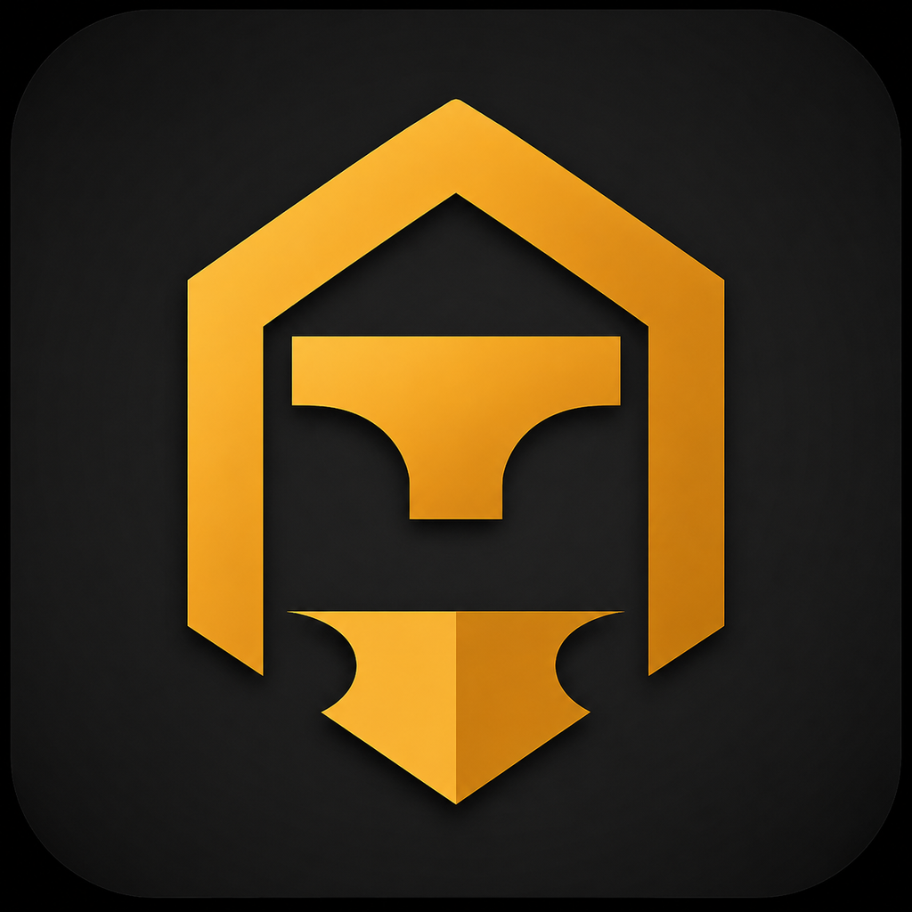

<p align="center">
  
</p>

<h1 align="center">TaskForge Mobile</h1>

<p align="center">
  TaskForge for Android and iOS, built with Flutter.
</p>

<p align="center">
  <a href="https://github.com/Abdullah-Masood-05/taskforge-mobile/actions/workflows/ci.yml"></a>
  <a href="https://github.com/Abdullah-Masood-05/taskforge-mobile/releases/latest"></a>
  
  
</p>

TaskForge Mobile talks to the same API as the [web app](https://taskforge-app-869.netlify.app)
and the [desktop app](https://github.com/Abdullah-Masood-05/taskforge-desktop), so your
accounts, organizations, projects and boards are the same everywhere. It uses the web app's
dark terminal look: a warm near-black background, amber accents, thin borders and monospace
section labels.

## Try it

Download the APK from the [latest release](https://github.com/Abdullah-Masood-05/taskforge-mobile/releases/latest)
and install it on an Android phone. Sign in with the demo account, which has a seeded
organization and a 150-task project with charts, a timeline and activity history:

| Email | Password | Role |
| --- | --- | --- |
| `admin@taskforge.dev` | `TaskForge2024!` | Admin |
| `alice@taskforge.dev` | `TaskForge2024!` | Member |
| `bob@taskforge.dev` | `TaskForge2024!` | Viewer |

The login screen has a "Use demo account" button that fills in the admin login. The API runs
on Render's free tier, so the first request after a quiet spell can take about 50 seconds
while the server wakes up.

## Features

- Sign in and register with JWTs. Expired access tokens are refreshed in the background, the same way the web client does it.
- Switch between organizations, create new ones, invite members, change roles and see pending invitations.
- Search, filter and sort projects, and create, edit, archive or delete them.
- Drag tasks between Kanban columns, or move them from a menu. Filter the board by priority, assignee, label or text, and add columns.
- Each project has an overview tab with progress, a priority donut and weekly velocity, plus a Gantt-style timeline and an activity feed.
- Task detail covers inline editing, subtasks, comments, activity history and attachments.
- The inbox loads notifications as you scroll, marks them read with a swipe, and shows an unread count on the tab bar.
- Billing shows the current plan, the pricing table and a link to the Stripe customer portal.
- Board changes from other people arrive live over a WebSocket.

## Running locally

```bash
flutter pub get
flutter run                     # uses the production API
flutter run --dart-define=API_URL=http://10.0.2.2:8000 \
            --dart-define=WS_URL=ws://10.0.2.2:8000   # local backend from the Android emulator
```

For a local backend, run `python manage.py seed` and
`python manage.py seed_demo_project --large-project` in
[taskforge-backend](https://github.com/Abdullah-Masood-05/taskforge-backend) to create the demo
accounts above.

## Project structure

```
lib/
  core/        config, theme tokens, API client (Dio), auth, router (go_router)
  data/        models, repository (every API endpoint), shared providers
  widgets/     shared components (buttons, cards, badges, skeletons)
  features/    auth, shell, dashboard, orgs, projects, board, task,
               notifications, profile, billing
```

State lives in [Riverpod](https://riverpod.dev). The auth controller does the job of the web
app's Zustand store, and `FutureProvider`s do the job of TanStack Query.

## CI and releases

`.github/workflows/ci.yml` runs on every push and pull request. It checks formatting, runs
`flutter analyze` and `flutter test`, builds a release APK (uploaded as an artifact) and builds
iOS without code signing.

`.github/workflows/release.yml` runs when a `v*` tag is pushed. It builds a universal APK,
per-ABI APKs and an App Bundle, and attaches them to a GitHub release. To sign with your own
key, add the `ANDROID_KEYSTORE_BASE64`, `ANDROID_KEYSTORE_PASSWORD`, `ANDROID_KEY_ALIAS` and
`ANDROID_KEY_PASSWORD` secrets. Without them the release is signed with the debug key.

## Related repositories

| Repo | What it is |
| --- | --- |
| [taskforge-backend](https://github.com/Abdullah-Masood-05/taskforge-backend) | Django REST and Channels API |
| [taskforge-frontend](https://github.com/Abdullah-Masood-05/taskforge-frontend) | Next.js web app |
| [taskforge-desktop](https://github.com/Abdullah-Masood-05/taskforge-desktop) | Tauri desktop app |
| [taskforge-site](https://github.com/Abdullah-Masood-05/taskforge-site) | Documentation |

## License

[GPL-3.0](LICENSE). Geist and JetBrains Mono are bundled under the SIL Open Font License
(see `assets/fonts`).
